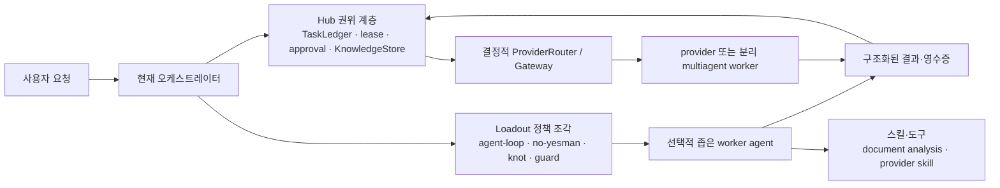

# Agent 형태 전환 적합성 평가

점검일: 2026-10-21
범위: Agent Hub 모듈, Hub에 설치된 Loadout 조각, 분리된 multiagent workspace,
승인 등록·발견 스킬

## 결론

모듈·조각·스킬을 가능한 한 모두 에이전트로 바꾸면 완성도는 올라가지 않는다. 이
시스템의 품질은 **권위의 단일성**(원장·lease·승인), **정책의 세션 내 적용**,
**도구의 결정적 계약**에서 나온다. 이를 자율 에이전트로 바꾸면 상태 복제, 권한
우회, 중복 호출, loop 폭주가 늘어난다.

품질을 올리는 구조는 다음과 같다.

> **모듈은 권위와 상태를 소유한다. 조각은 행동 정책을 준다. 스킬은 제한된 능력을
> 제공한다. 에이전트는 이 셋을 사용해 좁고 검증 가능한 판단 작업만 수행한다.**

따라서 현재는 광범위한 전환을 하지 않는다. 이미 존재하는 읽기 전용 발견·초안·독립
검토 경로를 좁은 worker agent로 명확히 취급하고, 필요가 생길 때만 두 종류의
선택적 worker를 추가하는 것이 적합하다.

## 평가 기준

어떤 항목을 에이전트로 만들려면 아래 다섯 조건을 모두 만족해야 한다.

1. 모델의 해석·계획이 실제 가치를 더한다.
2. 입력, 출력, 성공·실패가 좁은 계약으로 표현된다.
3. 정본 상태와 최종 권한은 별도 서비스 또는 원장에 남는다.
4. 읽기·쓰기 권한, 비용, timeout, 재시도 횟수를 제한할 수 있다.
5. 같은 일을 기존 도구·지침·서비스만으로 더 단순하게 할 수 없다.

한 조건이라도 빠지면 agent화가 아니라 지침, 도구, 서비스 또는 저장소로 남기는
편이 품질에 유리하다.

## 권장 파이프라인

`Authority`는 에이전트가 아니다. 에이전트는 lease를 빼앗거나 KnowledgeStore와
Knot 사이를 자동 복사하거나 guard 정책을 바꾸지 않는다.

## 항목별 판정

| 항목 | 현재의 올바른 형태 | agent 전환 판정 | 품질상 이유 |
|---|---|---|---|
| `improvement-observer` | 승인·sandbox·rollback을 가진 직렬 서비스 | **그대로 유지** | 한 번에 하나만 승격하고, attested review와 승인 후에만 실행하는 것이 핵심이다. 자율 patch agent로 바꾸면 신뢰 사슬이 약해진다. |
| `discovery.py` / `improvement_review.py` | 읽기 전용 발견·초안·독립 검토 작업 | **이미 좁은 worker agent 경계** | 모델 출력은 JSON 계약, source fingerprint와 review receipt로 묶인다. observer 자체를 바꾸기보다 이 경계를 명시·시험하는 편이 낫다. |
| `knowledge-mesh` | scope·version·tombstone을 가진 저장소 서비스 | **그대로 유지** | 저장소의 일관성은 결정적 연산과 단일 DB 정본에 달려 있다. 중재 agent는 version/tombstone 규칙을 비결정적으로 만든다. |
| `orchestration-handoff` | TaskLedger lease와 ProviderRouter를 가진 결정적 manager | **그대로 유지** | lease·handoff·제한 fallback은 중앙 권위여야 split-brain과 중복 dispatch를 막는다. 해석적 추천이 필요하면 manager 밖의 조언 worker만 추가한다. |
| `skill-registry` | 스킬 메타데이터 등록·발견 인덱스 | **그대로 유지** | 실행하지 않는 인덱스에 판단 agent를 넣을 이유가 없다. provider별 설치·실행은 별도 계약이다. |
| `agent-loop` | 직접 세션의 완료·검증 정책 | **그대로 유지** | 외부 agent로 빼면 현재 세션의 행동을 보장하지 못한다. 완료 판단은 오케스트레이터가 책임진다. |
| `no-yesman` | 제안·결론을 공격하는 세션 정책 | **현재는 유지, 후에 critic worker 후보** | 단독 입출력·거부권이 아직 없다. 특정 산출물의 수용 게이트가 필요해질 때만 existing review receipt 위에서 critic으로 구현한다. |
| `knot` | 외부 vault 선택 연동 도구 | **도구/adapter로 유지** | Hub KnowledgeStore와 의도적으로 자동 동기화하지 않는다. agent화가 이 경계를 흐리면 중복·범위 침해가 생긴다. |
| `guard` | `/goal` 비용 정지 hook·watcher | **그대로 유지** | 판단 정책은 `coach`가 정본이고 현재 runtime은 `off`다. 에이전트화보다 활성화 후 종료 수용시험이 먼저다. |
| `multiagent` | 분리 workspace의 manager + worker-pool scaffold | **이미 agent 시스템** | Hub 안에 다시 복제하지 않는다. 명시 bridge와 receipt 계약의 정합성을 계속 확인하는 것이 품질 개선이다. |
| `coding-principles` | 구현 정책 지침 | **그대로 유지** | 명시 요청 때 읽는 단일 정본이다. 판단·실행 단위가 아니다. |
| `document-analysis` | 결정적 추출·OCR·검증 도구 절차 | **스킬로 유지, 선택적 worker의 능력으로만 사용** | 현 스킬은 LLM을 호출하지 않고 원본 불변·출력 위치·검증을 엄격히 다룬다. 이를 상시 agent로 바꾸면 파일 쓰기와 해석의 위험만 늘어난다. |
| 제공자별 발견 스킬 | 각 provider가 소유한 설치물 | **중앙 agent화 금지** | 발견됨은 그 provider의 설치 근거일 뿐 공통 실행 계약이 아니다. 이름이 같아도 구현과 권한이 다를 수 있다. |

## 선택적으로 만들 가치가 있는 worker 두 가지

### 1. 증거 기반 critic worker

`no-yesman`을 모든 대화의 별도 agent로 만들지 않는다. 대신 코드 변경, 설계안,
문서 결론처럼 **명시적 산출물**이 있을 때만 호출하는 읽기 전용 critic worker가
후보이다. 입력은 산출물·완료 기준·근거 목록, 출력은 `pass` 또는
`return_to_design`과 반례·누락 근거의 구조화된 JSON이다.

사전조건은 기존 `improvement_review.py`의 review receipt와 같은 원장 경계를
재사용하는 것이다. critic은 승인·배포·수정 권한을 갖지 않는다.

최소 수용시험:

- 근거 없는 `pass`, 잘못된 schema, timeout은 수용되지 않는다.
- 같은 산출물 fingerprint의 재호출은 중복 영수증을 만들지 않는다.
- critic 실패가 TaskLedger lease, 원본 파일, 승인 상태를 바꾸지 않는다.
- 반례가 있는 산출물은 `return_to_design`으로 기록된다.

### 2. 문서 증거 reviewer worker

`document-analysis` 스킬 자체를 agent로 변환하지 않는다. 사용자가 독립적인 문서
판단을 요청한 경우에만, 스킬의 검증된 추출물을 입력으로 받아 페이지·표·OCR 한계를
인용하는 읽기 전용 reviewer worker를 둘 수 있다.

사전조건은 원본 파일과 추출 산출물의 해시, scope, 출력 JSON schema, provider별
읽기 권한, 비용·timeout 상한이다. worker는 원본을 수정하거나 외부 업로드하지 않으며
결과는 TaskLedger 또는 요청별 artifact로만 남긴다.

최소 수용시험:

- 암호화·OCR 실패·출력 디렉터리 쓰기 불가가 명시적 실패로 귀결된다.
- 페이지·좌표 인용이 없는 결론은 수용되지 않는다.
- provider가 달라도 같은 schema를 반환하거나, 지원하지 않음을 명시한다.
- 원본 파일 해시가 바뀌면 기존 결론을 재사용하지 않는다.

## Claude와의 반대 검토

Claude에는 두 번의 제한된 독립 검토를 요청했다. 첫 검토는 이 문서에 적은 코드
사실 묶음만 보고 전면 agent화에 반대했다. 두 번째 검토는 그 결론을 공격했고 다음
두 반례를 제시했다.

- **권위와 판단을 분리할 수 있다.** 중앙 원장·승인은 service로 유지하면서, 해석적
  판단만 narrow worker로 분리할 수 있다. 현재 `discovery.py`와
  `improvement_review.py`가 이미 이 패턴의 근거다.
- **multiagent에도 같은 계약 잣대를 적용해야 한다.** “이미 agent 시스템”이라는
  이유만으로 신뢰하지 말고, Hub bridge의 fingerprint·receipt·scope 제약을 계속
  수용시험해야 한다.
- `no-yesman`과 `coding-principles`가 실제로 다른 산출물을 판정·거부해야 하는
  요구가 생기면 policy에서 verifier worker로 승격할 수 있다. 현재는 그런 독립
  계약과 거부권이 없으므로 승격하지 않는다.

Claude의 저장소 직접 탐색형 긴 검토는 시간 제한 전에 결과가 확보되지 않아 이
판정의 근거로 쓰지 않았다. 완료된 두 검토는 도구 없이 제공된 증거 묶음을 평가한
것이며, 코드 경로의 정본은 이 문서에 인용한 Hub 소스와 시험이다.

## 근거 경로

- 권위·lease·handoff: `src/agent_hub/ledger.py`, `src/agent_hub/orchestration.py`,
  `src/agent_hub/provider_gateway.py`, `src/agent_hub/routing.py`
- 개선 worker와 승격 경계: `src/agent_hub/discovery.py`,
  `src/agent_hub/improvement_review.py`, `src/agent_hub/observer.py`,
  `src/agent_hub/sandbox.py`, `src/agent_hub/multiagent_improvement.py`
- 지식·스킬: `src/agent_hub/knowledge.py`, `src/agent_hub/skills.py`,
  `config/skills.json`
- Loadout 역할·설치·bridge: `AGENTS.md`, `CLAUDE.md`,
  `src/agent_hub/loadout_manager.py`, `src/agent_hub/loadout_bridge.py`,
  `/home/sungt/loadout-workspace/README.md`
- 스킬 계약: `/home/sungt/agent-skills/document-analysis/SKILL.md`,
  `/home/sungt/agent-skills/coding-principles/SKILL.md`

## 다음 구현 판단

지금 새 agent를 만들지 않는다. 먼저 실제 요청에서 “독립 critic이 필요하다” 또는
“문서 추출물의 별도 판단이 필요하다”는 반복 수요가 확인될 때만 위의 최소 계약과
수용시험을 구현한다. 그 전에는 기존 worker 경계를 이름만 바꾸거나 새 실행 권한을
만들지 않는 편이 더 완성도 높은 구조다.
