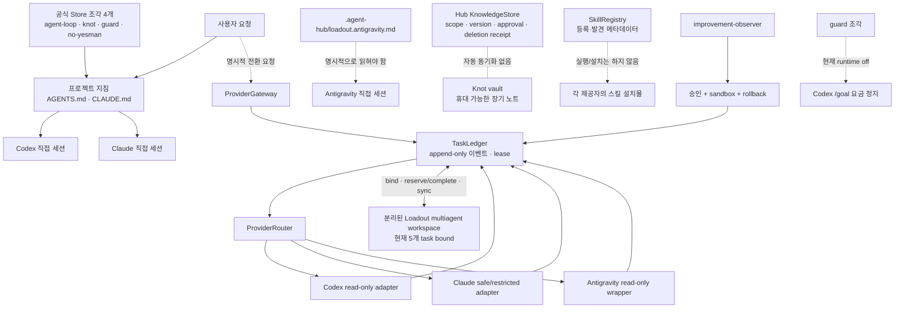

# Agent Hub · Loadout 통합 품질 점검

점검일: 2026-10-21
대상: `/home/sungt/agent-hub`, 활성 Store 조각, `/home/sungt/loadout-workspace` 작업 브리지, 현재 발견된 스킬

## 판정

핵심 제어 경로는 맞물려 있다. Hub는 실행·원장·승인·전환을 맡고, Loadout 조각은
직접 작업 세션의 행동 규칙을 맡는다. 이 둘은 같은 기능을 이중 실행하지 않으며,
`TaskLedger`와 명시적 task bridge에서 만난다.

그러나 전체가 완전한 자동 장치인 것은 아니다. Codex와 Claude의 새 직접 세션은
실제로 네 조각을 읽었다. Antigravity는 안전 래퍼와 최신 오버레이는 있지만 이번
점검에서 쿼터가 소진되어 실제 세션을 확인하지 못했다. guard는 배선돼 있으나 전역
스위치가 `off`다. 또한 Store가 만든 부속 파일은 아직 Git 추적 대상이 아니다.

## 블록 다이어그램



실선은 현재 코드 또는 설치물로 연결된 경로이고, 점선은 의도적 경계나 수동 조건이다.
직접 세션과 Hub Gateway는 같은 것이 아니다. Gateway의 Claude 호출은 의도적으로
`--safe-mode --restricted`를 사용하므로 `CLAUDE.md`, 플러그인, Store 조각을 읽지
않는 제한된 검토 경로다. 직접 Claude 작업 세션이 지침을 읽는다는 증거를 Gateway
검토 호출에까지 확대하면 안 된다.

## 현재 상태와 근거

| 연결부 | 상태 | 확인한 근거 | 판정 범위 |
|---|---|---|---|
| Hub 모듈 | 통과 | `improvement-observer`, `knowledge-mesh`, `orchestration-handoff`, `skill-registry`가 모두 `enabled=true` | 설정 상태 |
| Hub 오버레이 | 통과 | `loadout verify`가 codex·claude·antigravity 모두 `current` | 생성 파일 일치 |
| Store 조각 | 통과 | `AGENTS.md`와 `CLAUDE.md`에 네 관리 블록, Store `doctor`가 구조·부속 파일·guard hook을 통과 | 설치 무결성 |
| Codex 직접 세션 | 통과 | 무도구 새 세션이 agent-loop, knot, guard, no-yesman, knowledge boundary를 모두 `true`로 응답 | 새 세션의 지침 발견 |
| Claude 직접 세션 | 통과 | 무도구 새 세션이 같은 다섯 항목을 시작 문맥에서 받았다고 응답 | 새 세션의 지침 발견 |
| Hub → Codex 실제 경로 | 통과 | 임시 원장에서 `requested provider=codex`, 실행 `succeeded`, `HUB_AUDIT_OK`, 기록된 실행 1건, lease 해제 확인 | 현재 코드의 read-only 한 번 실행 |
| Hub ↔ multiagent | 통과 | Loadout workspace의 5개 task가 모두 `already_bound`; 재바인딩·중복 외부 호출은 fail-closed 코드와 시험으로 보호 | 기존 연결 task |
| Antigravity | 조건부 | 오버레이는 `current`, `agy-readonly-review` 래퍼는 존재하고 raw binary 우회를 막는다 | 실제 새 세션은 쿼터 429로 미확인 |
| guard | 배선만 통과 | Store doctor는 hook·watcher를 확인했으나 `coach guard status`는 `runtime_enabled=false` | `/goal` 자동 정지는 현재 비활성 |
| 스킬 | 부분 통과 | 2개 승인 등록 + 31개 제공자별 발견 항목 | 발견은 실행 가능성·공급자 간 호환성을 뜻하지 않음 |
| 재현성 | 보완 필요 | 지침 파일은 추적되지만 Store가 만든 `.claude/settings.json`, `_shared/guard/`, `prep/`은 untracked | 새 clone에서 동일 설치가 보장되지 않음 |

Antigravity의 실제 실행 실패 메시지는 `Individual quota reached`였다. 따라서 이번
점검은 Antigravity 자동 지침 로드나 Claude↔Codex↔Antigravity 자동 전환을 검증한
것으로 주장하지 않는다.

## 겹쳐 보이는 부분의 역할 분리

| 겹쳐 보이는 요소 | 실제 역할 | 품질 판단 |
|---|---|---|
| `agent-loop` / `improvement-observer` | 전자는 일반 작업의 완료·검증 행동 규칙, 후자는 승인된 코드 개선 후보의 sandbox 실행·rollback | 중복 실행 없음 |
| `knowledge-mesh` / `knot` | 전자는 Hub 소유의 범위·버전·삭제 영수증 저장소, 후자는 외부 vault의 휴대 가능한 장기 지식 | 자동 복사를 하지 않도록 경계 명시. 사람이 같은 내용을 두 곳에 쓰는 위험은 남음 |
| `orchestration-handoff` / `multiagent` | 전자는 provider 전환과 lease를 Hub 원장으로 통제, 후자는 분리 workspace의 worker-pool 스캐폴드 | 5개 task의 명시 bridge로만 연결. Hub 내부에 multiagent scaffold를 덮어쓰지 않음 |
| `guard` / Router의 limit handoff | guard는 Codex `/goal`의 주간 사용량 정책, Router는 이미 발생한 제한·timeout·network 실패의 task 전환 | 같은 비용 안전망이지만 시점과 대상이 다름 |
| `no-yesman` / Architecture evidence gate | 전자는 사용자 제안의 약점·반례를 먼저 찾는 태도, 후자는 구현 완료 주장에 필요한 증거 순서 | 상호 보완. 둘 다 비판을 요구하지만 하나는 판단 태도, 하나는 증거 기준 |
| `skill-registry` / 제공자 스킬 | Registry는 목록·설명·출처만 다루며 스킬을 설치·로드·실행하지 않음 | 의도적 경계. 이름만 같아도 제공자별 구현은 별개 |

현재 스킬은 총 33개다. Hub Registry에 승인 등록된 것은 `coding-principles`,
`document-analysis` 두 개이며 Codex에서는 native, Claude·Antigravity에서는
conditional로 표시된다. 나머지 31개는 제공자 설치 경로에서 발견한 항목이다.
발견 수는 Codex 7, Claude 19, Antigravity 11이다. 예를 들어 `knot`,
`configure-store`, `configure-multiagent`, `engram-memory`는 현재 Claude 전용
설치물이다. 따라서 Codex가 Store 문구를 읽는 것과 Claude 플러그인 스킬을 똑같이
실행할 수 있다는 것은 다른 주장이다.

## 이번 점검에서 고친 불일치

Store의 `agent-loop`에는 반복 상한에 도달하면 사람에게 보고하고 멈춘다는 문장이
있다. 프로젝트의 provider-neutral 완료 루프는 실제 blocker가 없으면 완료 조건을
계속 검증·수정하도록 요구한다. 둘을 그대로 두면 단순한 임의 횟수가 중단 사유처럼
읽힐 수 있었다.

`AGENTS.md`와 `CLAUDE.md`에 **Completion loop precedence**를 추가했다. Store
블록은 손대지 않았고, 상한은 진단 신호일 뿐 중단 권한이 아니며 실제 blocker가
없으면 독립적으로 가능한 작업을 계속하고 재검증하도록 명시했다. 이어쓰기 문서의
날짜와 “세 조각” 표기도 현재 네 조각에 맞게 고쳤다.

## 남은 보완 순서

1. Antigravity 쿼터가 복구된 뒤, 안전 래퍼로 새 세션을 한 번 실행해 오버레이를
   자동으로 읽는지 또는 명시 주입이 필요한지 확인한다. 현재 도움말과 설명서는
   명시 주입이 필요할 수 있다고만 말한다.
2. Store 생성 부속 파일을 버전 관리할지, clone 뒤 공식 Store 설치를 재현하는
   bootstrap을 둘지 결정한다. 둘 중 하나가 없으면 지침 블록만 복제되고 템플릿·guard
   배선은 빠질 수 있다.
3. `/goal` 사용량 제한을 실제로 강제하려는 경우에만 `coach guard on`을 켠 뒤,
   app-server·remote session·watcher까지 포함한 종료 수용시험을 실행한다. 현재의
   `off`는 실패가 아니라 비활성 정책 상태다.
4. 모든 provider에서 같은 스킬 동작이 필요하다면, Registry의 `conditional` 표기를
   실제 설치·conformance test로 바꾼다. 목록에 보이는 것만으로는 이식성이 생기지
   않는다.

## 이번 점검의 최종 재검증

- `python scripts/verify_portability.py`: `compileall` 통과, 단위시험 168개 통과,
  `uv pip check` 통과.
- `loadout verify`: 세 provider 오버레이 모두 `current`.
- Store `doctor`: 두 지침 파일의 네 조각, agent-loop 템플릿, guard hook·watcher가
  모두 정상.
- Loadout `_shared/check-invariants.sh`: 16 PASS, 0 FAIL.
- Loadout `verify-loadout-compat.sh`: 모든 호환성 항목 PASS. 이 검사는 guard가
  계속 `off`인 것도 확인했다.
- `git diff --check`: 통과.

## 재검증 명령

```bash
cd /home/sungt/agent-hub
.venv/bin/python -m unittest discover -s tests
python scripts/verify_portability.py
bash /home/sungt/loadout-workspace/_shared/check-invariants.sh
bash /home/sungt/loadout-workspace/scripts/verify-loadout-compat.sh
.venv/bin/python -m agent_hub.cli loadout --hub-root . verify --project-root .
.venv/bin/python -m agent_hub.cli loadout --hub-root . manage --source fragment --action doctor --project-root .
git diff --check
```
